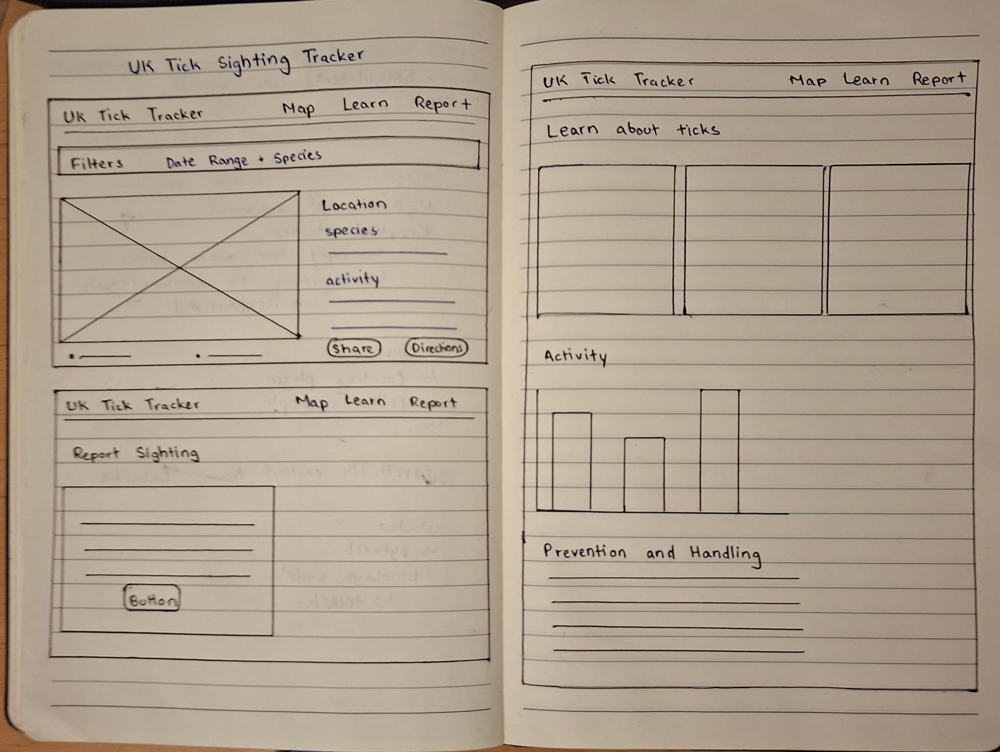
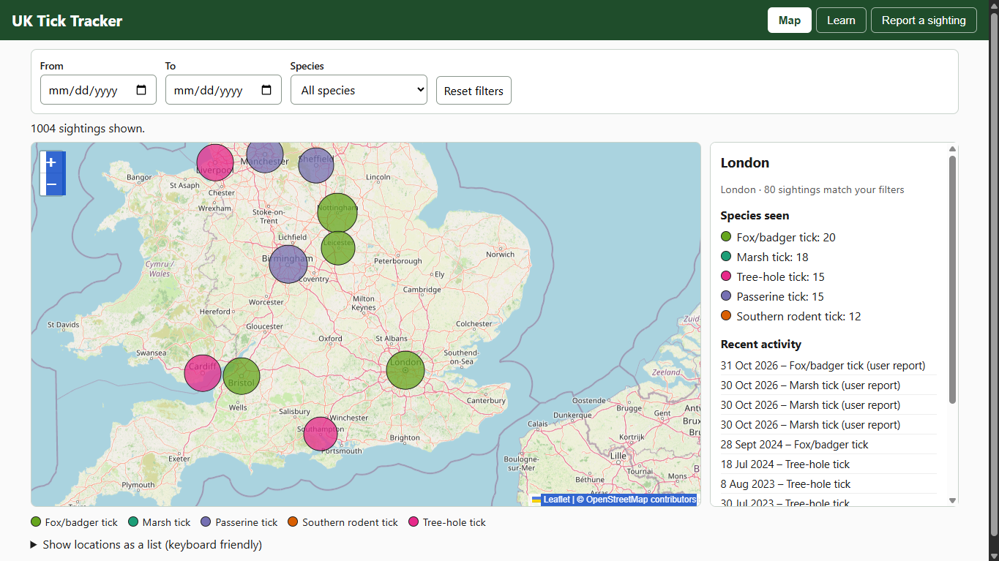
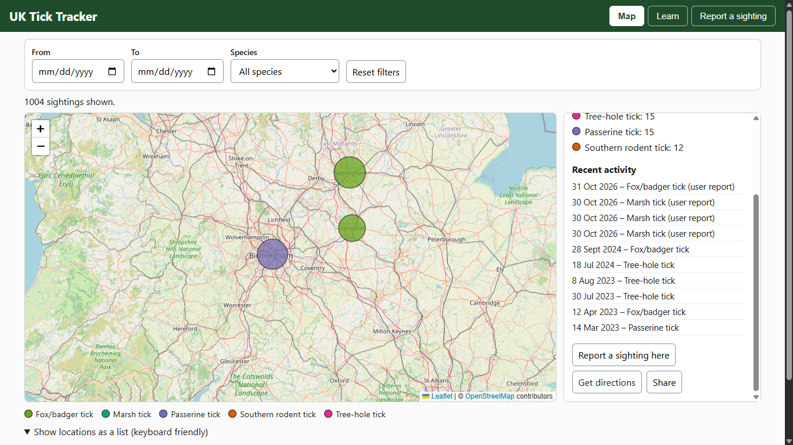
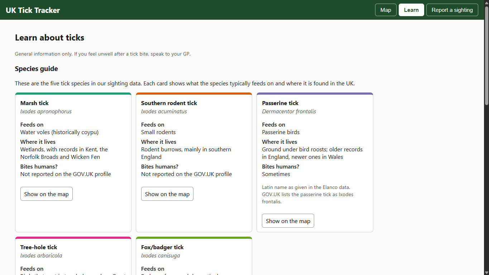
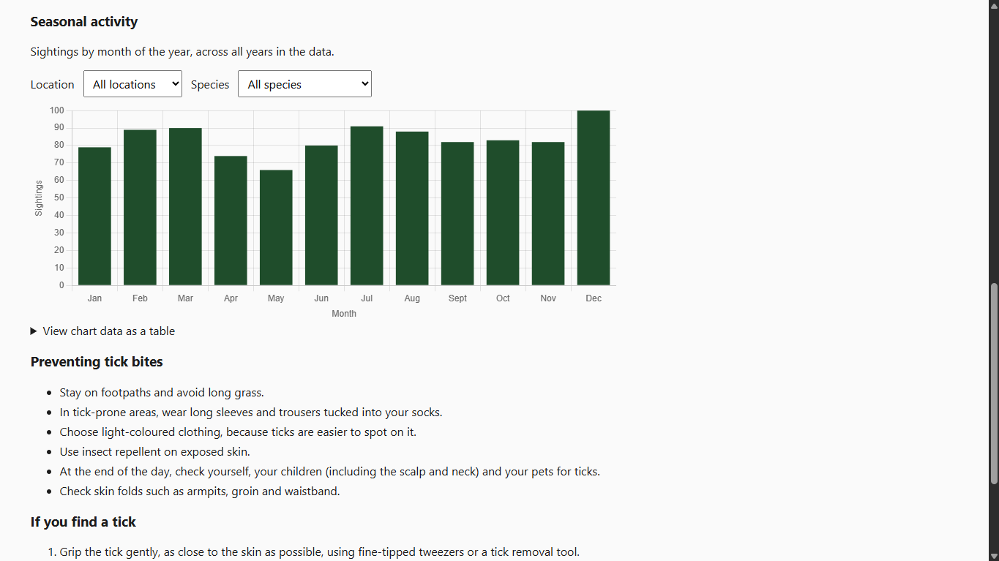
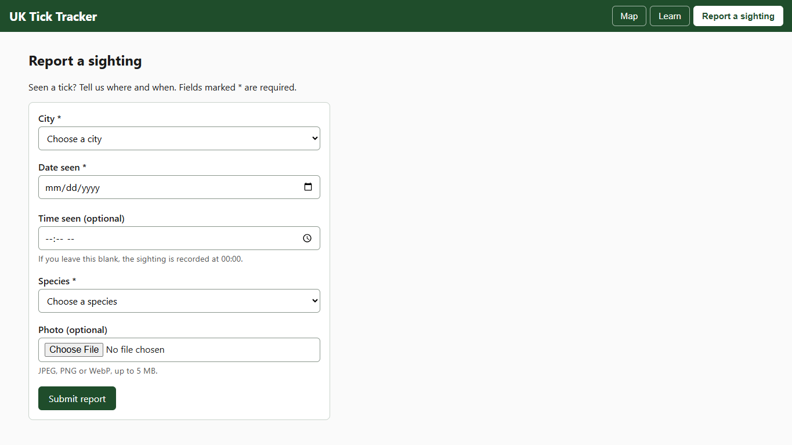
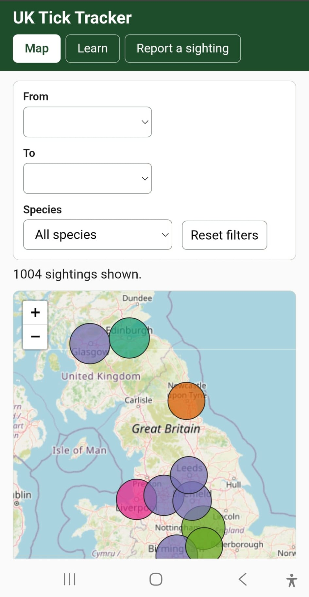

# Design

This folder holds the wireframe I drew before building the front end, and screenshots of the finished app.

**Author:** Kingshuk Paul Peash

## Who it is for

- **Pet owners** who want to see tick activity, learn how to spot and avoid ticks, and report a sighting.
- **Vets** who want to explore sightings by area and time.
- **Contributors** who want to submit a report quickly, with a photo.

## Wireframe

One sketch covers the four main screens: the map with filters, the sighting side panel, the Learn tab and the report form.

The screenshots below show how each screen turned out, along with the decisions behind it.

## 1. Map and filters

The map is the home screen. Each city has one bubble, sized by the number of sightings and coloured by its most common species. Filters sit above the map.

**Decisions**
- The map takes most of the page, because it answers the main question: where are ticks being seen?
- Bubbles show species by colour and amount by size, so the picture reads at a glance.
- A date range and species filter sit above the map, where users look first.
- A legend explains the colours. Species are also named in the side panel, so colour is never the only signal.

## 2. Sighting panel

Clicking a bubble opens a side panel with a species breakdown and recent activity for that city. It has three quick actions: **Report**, **Get directions** and **Share**.

**Decisions**
- A side panel keeps the map visible, so users can click between cities and compare. A pop-up would hide the map.
- The **Report** button fills in the city on the report form, so the user doesn't retype it.
- On a phone the panel moves below the map.

## 3. Learn

The Learn tab holds a species guide, bite-prevention and tick-removal advice, and a seasonal activity chart.

**Decisions**
- Each species card has the same colour as its map bubble, so users can link a card to what they see on the map.
- A **Show on the map** button on each card filters the map to that species.
- The chart has location and species dropdowns, a table version of the same data, and a y-axis that starts at zero so differences are not exaggerated.
- Health advice is general information only, and links to its sources (GOV.UK and nidirect).

## 4. Report a sighting

**Decisions**
- A short form with only what is needed: city, date, time, species and an optional photo.
- Cities and species come from dropdowns, which prevents typing mistakes.
- Errors appear next to each field and in a summary at the top. Warnings, such as an old date, don't block the user from submitting. Success is a clear confirmation, and the map updates straight away.
- The server repeats every check, because the browser's checks can be bypassed.

## Accessibility decisions

- Every form field has a visible label, and errors are linked to their fields.
- All controls work with a keyboard, with a visible focus outline and a "skip to content" link.
- Status and error messages are announced to screen readers.
- The seasonal chart has a text description and a data table.
- Species are identified by name as well as colour.

## Responsive layout

The layout is designed to work from desktop to phone. On narrow screens the side panel and filters stack beneath the map.

## Files in this folder

| File | What it shows |
| --- | --- |
| `wireframe.jpeg` | Wireframe of all four screens |
| `screenshot-map.png` | Final map |
| `screenshot-panel.png` | Final side panel |
| `screenshot-learn-guides.png` | Final Learn tab |
| `screenshot-learn-charts.png` | Final Learn tab |
| `screenshot-report.png` | Final report form |
| `screenshot-mobile.jpeg` | Final app on a phone |
